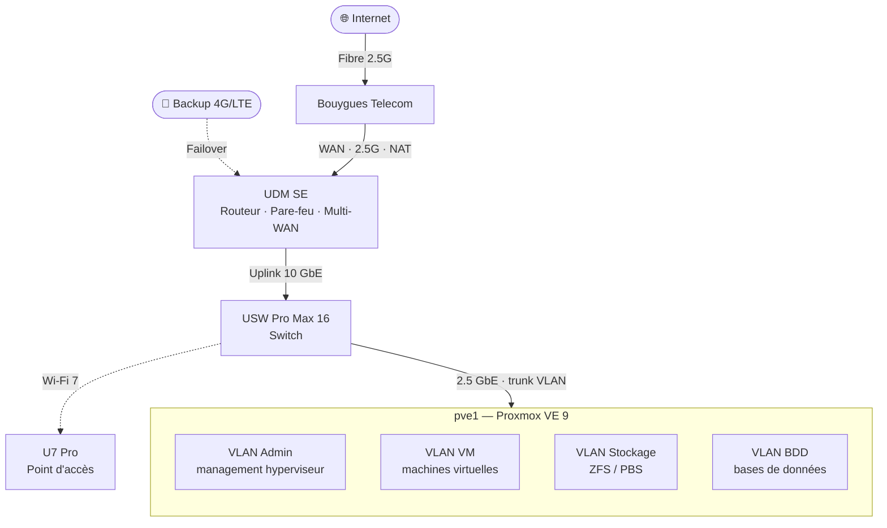

<h1 align="center">🏠 Homelab</h1>

<i>Mon laboratoire perso : virtualisation, services auto-hébergés et durcissement.</i>

  
  
  

---

## 🎯 Objectif
Un terrain de jeu pour tester, casser et apprendre : virtualisation, réseau,
services auto-hébergés, sauvegardes et durcissement.

---

## 🖥️ Matériel

### `pve1` — nœud principal
| Composant | Détail |
|---|---|
| Châssis | Dell OptiPlex 5070 |
| CPU | Intel Core i7-8700 (6c / 12t) |
| RAM | 64 Go |
| Réseau | 2 × 2,5 GbE |
| Hyperviseur | Proxmox VE 9 |

### Stockage NVMe
- Carte **KALEA PCIe x16 (ASM2824)** → **4 × SSD M.2 NVMe**
- Les 4 NVMe regroupés en **pool ZFS** (redondance + snapshots)
- Sauvegardes des VMs/CT via **Proxmox Backup Server (PBS)**

---

## 🌐 Réseau
Infrastructure **Ubiquiti UniFi** :

| Équipement | Rôle |
|---|---|
| UDM SE | Routeur / pare-feu / contrôleur UniFi |
| USW Pro Max 16 | Switch (VLAN, PoE) |
| U7 Pro | Point d'accès Wi-Fi 7 |

- **Segmentation en VLAN** (prod / lab / IoT / invités…) avec filtrage inter-zones en moindre privilège
- **Accès distant par VPN WireGuard** (léger, chiffrement moderne)
- WAN fibre

---

## 📦 Services auto-hébergés
> Hébergés principalement en **conteneurs Docker** (et quelques VM dédiées).

| Service | Rôle | Techno |
|---|---|---|
| Wazuh | SIEM — détection & analyse de logs | VM |
| BunkerWeb | Reverse proxy + pare-feu applicatif (WAF) | Docker |
| Grafana | Tableaux de bord & métriques | Docker |
| Zabbix | Supervision / monitoring | Docker |
| Ansible | Automatisation & gestion de configuration | VM (contrôleur) |
| Proxmox Backup Server | Sauvegardes des VM/CT | VM dédiée |

---

## 🧱 Ce que je travaille ici
- Virtualisation & haute dispo (Proxmox, ZFS, snapshots)
- Réseau : VLAN, segmentation, pare-feu
- Sauvegarde & restauration (tests de PRA à petite échelle)
- Durcissement système (Linux, SSH, mises à jour automatisées)
- Automatisation (Ansible)

---

## 🗺️ Schéma
## 🗺️ Schéma réseau

---

⚠️ Dépôt volontairement sans IP publique, hostname externe, port forward ni secret.

